# beanOS Icon Templates

This directory contains SVG icon templates designed for optimal display on e-ink screens, specifically for the Badger2040 device. These icons replace Unicode characters to ensure better compatibility and rendering on e-ink displays.

## Icon Categories

### Milestones (`icons/milestones/`)

Achievement icons for reaching coffee consumption milestones:

| Icon | File | Achievement | Description |
|------|------|-------------|-------------|
| 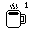 | `First coffee.png` | Erster Kaffee | First coffee ever! |
| 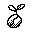 | `Coffee starter.png` | Kaffee-Starter | 10 coffees consumed |
|  | `Coffee fan.png` | Kaffee-Fan | 50 coffees consumed |
| 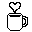 | `Coffee lover.png` | Kaffee-Liebhaber | 100 coffees consumed |
| 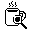 | `Coffee expert.png` | Kaffee-Experte | 500 coffees consumed |
| 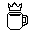 | `Coffee master.png` | Kaffee-Meister | 1000 coffees consumed |

### Streaks (`icons/streaks/`)

Achievement icons for consecutive day streaks:

| Icon | File | Achievement | Description |
|------|------|-------------|-------------|
|  | `Consistency expert.png` | Consistency Expert | 7 days in a row with coffee |
|  | `Consistency master.png` | Consistency Master | 30 days in a row with coffee |

### Special Drinks (`icons/special_drinks/`)

Achievement icons for trying special coffee drinks:

| Icon | File | Achievement | Description |
|------|------|-------------|-------------|
| 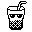 | `Stay cool.png` | Stay Cool | First iced latte consumed |
| 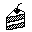 | `Dessert.png` | Dessert | First affogato consumed |
| 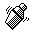 | `Shake it.png` | Shake it! | First shakerato consumed |

### Maintenance (`icons/maintenance/`)

Achievement icons for machine maintenance:

| Icon | File | Achievement | Description |
|------|------|-------------|-------------|
| 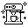 | `Clean machine.png` | Saubere Maschine | First maintenance completed |
| 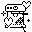 | `Maintenance master.png` | Wartungsmeister | All maintenance tasks on time |

### Experimental (`icons/experimental/`)

Achievement icons for experimental challenges:

| Icon | File | Achievement | Description |
|------|------|-------------|-------------|
| 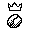 | `Barista.png` | Barista | All drink types tried |
| 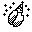 | `bean day.png` | Happy Bean Day | 10 coffees in a single day |

### General (`icons/general/`)

General UI icons:

| Icon | File | Usage | Description |
|------|------|-------|-------------|
| 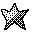 | `Star.png` | Daily Achievement Indicator | Appears in title bar when achievement unlocked today |

## Design Guidelines

All icons follow these design principles for optimal e-ink display:

1. **High Contrast**: Black and white only, no gradients
2. **Simple Geometry**: Clear, bold shapes that render well at small sizes
3. **Consistent Size**: All icons are 32x32px viewBox
4. **Stroke Width**: Minimum 2px stroke width for visibility
5. **No Fine Details**: Avoiding thin lines or complex patterns that may blur

## Technical Specifications

- **Format**: SVG 1.1
- **Size**: 32x32px viewBox
- **Color Depth**: 1-bit (black and white)
- **Encoding**: UTF-8
- **Compatibility**: Optimized for Pimoroni Badger2040 e-ink display (296x128px)

## Usage in beanOS

These SVG templates are designed to work with e-ink displays without requiring Unicode font support. The icons can be:

1. **Pre-rendered**: Convert to 1-bit bitmaps for direct display
2. **Referenced**: Use as visual templates for screen mockups
3. **Documentation**: Include in README and documentation

### Current Implementation

The SVG templates in this folder are already converted to 1-bit `bytearray` bitmaps in `icon_bitmaps.py`.
`main.py` references symbolic icon IDs (for example `#1`, `=7`, `~`) in `get_achievement_definitions()`, and those IDs are resolved via `ICON_MAP` to the converted bitmap data.

### Future Integration

For changes to icon artwork, keep this workflow:

1. Update or add SVGs in this folder
2. Convert SVGs to 1-bit bitmap data
3. Update `icon_bitmaps.py` and `ICON_MAP` mappings

## File Structure

```
icons/
├── README.md                          # This file
├── milestones/
│   ├── milestone_1.svg               # #1
│   ├── milestone_10.svg              # #10
│   ├── milestone_50.svg              # #50
│   ├── milestone_100.svg             # #100
│   ├── milestone_500.svg             # #500
│   └── milestone_1000.svg            # #1000
├── streaks/
│   ├── streak_7.svg                  # =7
│   └── streak_30.svg                 # =30
├── special_drinks/
│   ├── iced_latte.svg                # ~
│   ├── affogato.svg                  # o
│   └── shakerato.svg                 # %
├── maintenance/
│   ├── clean_machine.svg             # <>
│   └── maintenance_master.svg        # []
├── experimental/
│   ├── barista.svg                   # >>
│   └── happy_bean_day.svg            # ^^
└── general/
    └── achievement_star.svg          # ★
```

## Converting to Badger2040 Format

To use these icons on the Badger2040, you'll need to convert them to a compatible format:

### Method 1: Convert to 1-bit PNG/BMP

```bash
# Using ImageMagick
convert icon.svg -depth 1 -colors 2 -colorspace Gray icon.png
```

### Method 2: Use Badger2040 Image Converter

Follow the Pimoroni Badger2040 image conversion guide to convert SVGs to the appropriate format for direct display.

### Method 3: Pre-render as Bitmap Arrays

Convert SVGs to MicroPython-compatible bitmap arrays and update `icon_bitmaps.py`.

## License

These icons are part of the beanOS project and are licensed under GNU GPLv3.

## Contributing

When adding new icons:

1. Follow the design guidelines above
2. Use consistent 32x32px viewBox
3. Keep designs simple and high-contrast
4. Test rendering at small sizes
5. Update this README with new entries

## Version History

- **v1.0** (2025-02-05): Initial icon set
  - Created all milestone icons (#1 through #1000)
  - Created streak icons (=7, =30)
  - Created special drink icons (~, o, %)
  - Created maintenance icons (<>, [])
  - Created experimental icons (>>, ^^)
  - Created general achievement star (★)
